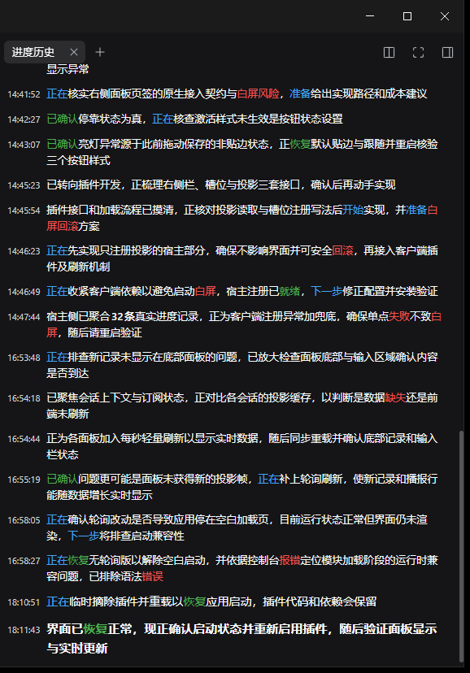

# dsh-plugin-progress-summary-history

给 [DeepSeek Harness](https://github.com/deepseek-ai/deepseek-harness)（DSH）右侧栏加一个
**「进度历史」面板**：把当前会话里所有进度播报按时间列出来，最新一条加粗。

社区插件，与 DSH 官方无关。

## 它和 dsh-progress-summary 的关系

```
dsh-progress-summary（另一个插件，MIT）  每跑一段写一条记录
        └─▶ 会话记录 plugin:progress-summary/line
                    └─▶ 本插件折叠成投影 progressHistory
                                └─▶ 右侧栏「进度历史」面板
```

- **必须先装** [`dsh-progress-summary`](https://github.com/tastynoob/dsh-progress-summary)，否则面板会是空的（会给出提示，不会报错）。
- 本插件**不复制**上游代码，只读它写下的记录类型；也不改写会话内容、不注入任何面向模型的内容。

## 安装

装进某个 profile（桌面版用应用内插件管理器，命令行直改会和它冲突）：

```sh
dsh plugin --profile web add dsh-plugin-progress-summary-history
```

从 GitHub Release 的固定 tag 安装：

```sh
dsh plugin --profile web add "https://github.com/neoiw0/dsh-plugin-progress-summary-history/releases/download/v0.1.3/dsh-plugin-progress-summary-history-0.1.3.tgz"
```

装完重启该 profile。

## 使用



面板规则：

- **时间正序**：最上面最老，最下面最新；新播报到达自动滚到底部。
- **字号分档**：最新一条比正文大 2 号并加粗，次新大 1 号，其余为基础字号。
- **重点着色（扫读优先）**：每行最多强调 3 处——1 个状态词（蓝=进行中 / 绿=已完成 / 红=需注意）＋ 2 个量或标识符（数字加粗、文件与命令用等宽弱紫），其余保持正文色。
- **时间**：相对显示（刚刚 / N 分钟前 / N 小时前），悬停可看精确时刻；最新一条左侧有蓝色竖线。


1. 打开会话的右侧栏；
2. 点标签条的「+」，引导页里选 **「进度历史」**；
3. 面板按时间正序列出本会话的播报，最新一条最大且加粗。

面板是会话级投影，**切换会话会自动跟着换**，不需要刷新。

## 兼容性

- 声明支持 DSH `0.2.1-rc.2`（`dsh.compatibility.dshReleases`）。
- 依赖上游插件的数据格式；上游若改记录名或字段，本插件需要同步升级。
- 无配置项。

## 限制

- 只读：没有搜索、没有复制按钮、没有导出。
- 只显示进度播报，不显示思考过程。
- 上游插件缺席时显示空状态提示。

## 卸载

```sh
dsh plugin --profile web remove dsh-plugin-progress-summary-history
```

## 许可

MIT，见 `LICENSE`；数据来源声明见 `NOTICE`。

## 安装与升级注意（重要）

这个插件的客户端半边（`client.js`）会和其它客户端插件打进同一批脚本：**它加载失败会把整批带崩**，表现是窗口卡在「Loading plugins…」或弹出「应用无法启动」。

因此安装/升级时请遵守两条：

1. **不要在 DSH 运行时直接把文件写进 profile 的 `node_modules`**。复制过程若被热重载读到半截文件，就会触发上面的崩溃。正确做法是先写到同目录临时文件，再原子改名（`mv` 覆盖），或干脆关掉应用再复制。
2. 改完先跑 `npm run check`（15 项，含"一行最多 3 处强调"与"引导入口 title/description 必须是函数"的回归断言），再装。

万一真的崩了：错误对话框里点「重启」即可恢复（文件此时已是一致的）；若仍失败，把 `package.json` 的 `dsh.profile.bundles` 里 `dsh-plugin-progress-summary-history` 暂时去掉，重载后再加回。

## 防复发：三条护栏（2026-10-24 事故后新增）

1. **不要往运行中的 profile 里复制文件**。改为装 tarball 快照：
   ```bash
   npm pack
   # profile 的依赖写成 file:<绝对路径>/dsh-plugin-progress-summary-history-<版本>.tgz
   pnpm install
   ```
   源码目录与运行中的应用解耦，改源码不再触发热重载。
2. **装之前跑 `npm run check`（20 项）**，其中三条静态断言正是当天两次启动失败的根因：
   - 客户端 `__ModuleLoader__.load({ id })` 必须等于包名（否则 duplicate factory registration）；
   - `cordis.patch.yml` 的行 `name` 必须等于包名；
   - 投影必须声明 `wire: { viewSchema, view }`（否则宿主不外发，面板永远空白）。
3. **profile 配置可自愈**：`npm run config:check` 只报告，`npm run config:fix` 幂等补回
   provider 块与播报配置行（写入前自动备份）。这两块曾被别的流程整体重置，症状是播报行消失。

## 播报（bar）用哪个模型：只能用免费档，且要控频

2026-10-24 实测结论（同一天反复踩过，记下来省得重来）：

| 尝试 | 结果 |
|---|---|
| `minimax-m3.1-flash-free`（曾可用） | HTTP 410 `ModelDeprecated`，官方已下线 |
| Zen 免费档（`mimo-v2.6-flash-free`/`glm-5.3-flash-free`/`deepseek-v4.1-flash-free` 等） | HTTP 403 `FreeTierError`：只允许 OpenCode 官方客户端调用 |
| `beam-free` | 部分地区 HTTP 403 `RegionError` |
| **`longcat-2.5-preview-free`**（go 端点） | **可用**：价格 0/0、约 5-6 秒出文 |

关键细节：这个免费模型有**突发限流**（约每 15 秒 3 次），超限返回
`429 {"message":"Upstream request failed: Endpoint is unavailable."}`；
DSH 适配器会把它吞成“空响应”，播报插件只记 `chars=0` 而不报错 —— 表现就是**bar 静默消失**。
因此播报配置里 `minIntervalMs` 用 45000（45 秒一次），稳稳落在免费额度内。

诊断这类问题时不要靠猜：`npm run verify:narrator` 会直接告诉你配置是否生效、
模型是否出文（`chars=0`）、以及是否发布了播报行。
